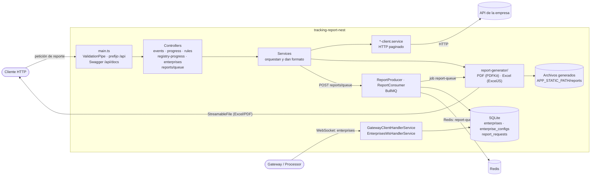

# Tracking Report Nest

Microservicio de generación de reportes (Excel/PDF) para una plataforma de rastreo
vehicular, construido con [NestJS](https://docs.nestjs.com).

## Descripción

El servicio recibe peticiones HTTP de reportes, consulta las bases de datos
operativas de cada empresa vía HTTP (paginado en streaming) y devuelve el resultado
como **Excel** o **PDF**. Además se conecta por **WebSocket** a un _gateway/processor_
central para recibir el catálogo de empresas y sus configuraciones de conexión.

Los reportes también pueden generarse de forma **asíncrona**: el cliente encola la
solicitud, el servicio crea un `ReportRequest`, publica un job en **BullMQ/Redis** y
un consumidor genera el archivo en segundo plano, actualizando el estado de la
solicitud y guardándolo bajo `APP_STATIC_PATH`.

Los datos de rastreo **no viven aquí**: viven en las bases de datos operativas de
cada empresa, a las que se accede por HTTP.



> Los diagramas (arquitectura, módulos, secuencias, ER y CI) están en
> [Arquitectura](./docs/05-arquitectura.md) y usan **Mermaid**.

## Documentación

Toda la documentación del proyecto vive en la carpeta [`docs/`](./docs/README.md):

| Documento                                                       | Contenido                              |
| --------------------------------------------------------------- | -------------------------------------- |
| [Índice](./docs/README.md)                                      | Punto de entrada y guía de navegación. |
| [Estado actual](./docs/01-estado-actual.md)                     | Qué hace hoy y deuda técnica.          |
| [Tecnologías](./docs/02-tecnologias.md)                         | Stack, versiones y propósito.          |
| [Instalación y ejecución](./docs/03-instalacion-y-ejecucion.md) | Cómo levantar el proyecto.             |
| [Variables de entorno](./docs/04-variables-de-entorno.md)       | Propósito de cada variable.            |
| [Arquitectura](./docs/05-arquitectura.md)                       | Módulos, flujo de datos y procesamiento asíncrono. |
| [API](./docs/06-api.md)                                         | Endpoints y ejemplos.                  |
| [Base de datos](./docs/07-base-de-datos.md)                     | SQLite, entidades y migraciones.       |
| [Testing y calidad](./docs/08-testing-y-calidad.md)             | Vitest, oxlint, Prettier y CI.         |
| [Despliegue](./docs/09-despliegue.md)                           | Build y ejecución en producción.       |
| [Glosario](./docs/10-glosario.md)                               | Términos del dominio.                  |

## Inicio rápido

```bash
# Instalar dependencias
pnpm install

# Configurar variables de entorno
cp .env.example .env

# Levantar Redis (requerido por la cola BullMQ)
docker compose -f containers/redis/docker-compose.yml up -d

# Aplicar migraciones
pnpm migration:run

# Desarrollo (watch)
pnpm start:dev
```

La API queda disponible en `http://localhost:${APP_PORT}/api` y la documentación
interactiva (Swagger) en `http://localhost:${APP_PORT}/api/docs`.

## Tests y calidad

```bash
pnpm lint        # oxlint type-aware
pnpm test        # pruebas unitarias
pnpm test:e2e    # pruebas end-to-end (requieren Redis)
pnpm test:cov    # cobertura
```

> Las pruebas e2e levantan `AppModule` completo y solo reemplazan
> `IntegrationsModule`; como `QueueModule` queda activo, necesitan **Redis**
> accesible en `REDIS_HOST:REDIS_PORT`. La suite e2e de CI lo provee como servicio.

## Requisitos

- Node.js 24
- pnpm 12.15.0
- Redis (requerido por la cola BullMQ en desarrollo, producción y e2e)
- Acceso SSH a GitHub (la dependencia `tracking-common` se instala desde un repo privado)

## Base de datos

Se usa **SQLite** con TypeORM. Las migraciones se ejecutan contra el build compilado:

```bash
pnpm migration:generate   # generar
pnpm migration:run        # aplicar
pnpm migration:revert     # revertir
pnpm migration:validate   # ver SQL pendiente
```

Ver [Base de datos](./docs/07-base-de-datos.md) para más detalle.

## Licencia

UNLICENSED — uso privado.
