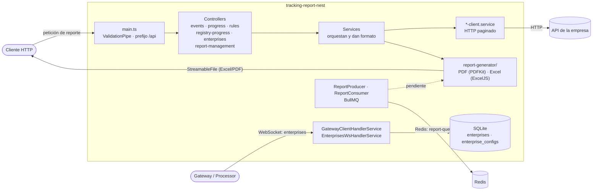
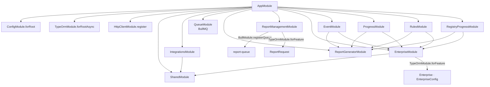
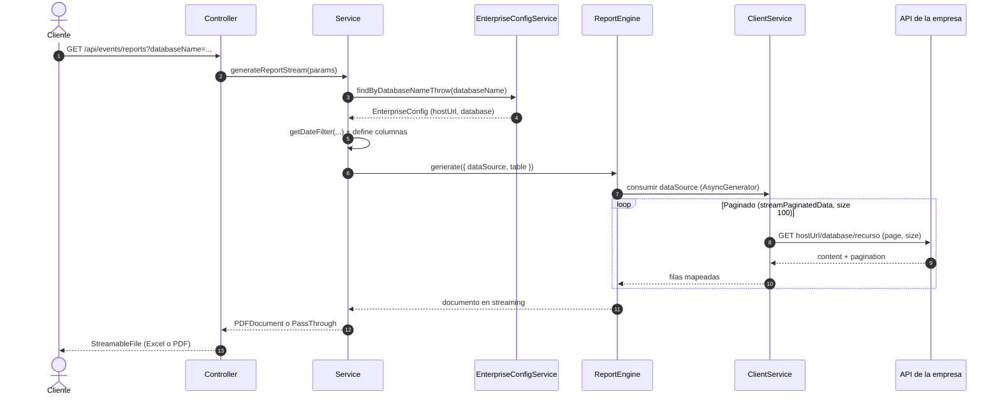
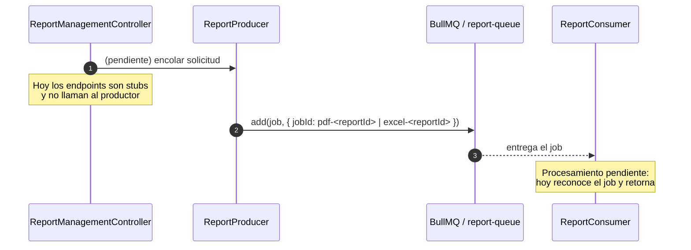
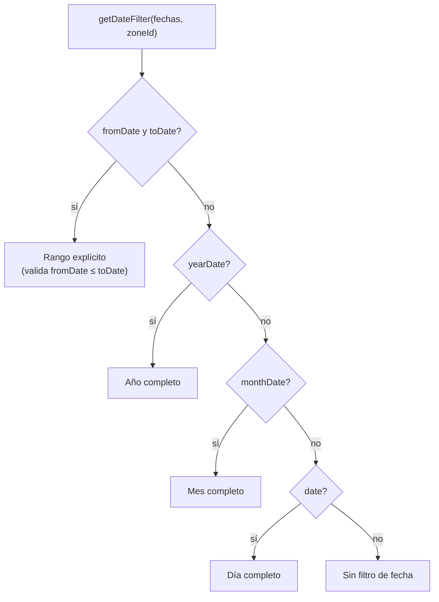
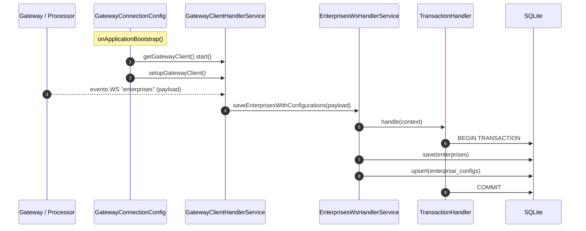

# 05 — Arquitectura

## Visión general

`tracking-report-nest` es un servicio NestJS con tres caras:

1. **Servidor HTTP** — recibe peticiones de reportes y las resuelve devolviendo
   Excel o PDF en streaming.
2. **Cliente WebSocket** — se conecta a un *gateway/processor* central para recibir
   el catálogo de empresas y sus configuraciones de base de datos.
3. **Cola de reportes** — registra y procesa trabajos de generación mediante
   **BullMQ** y **Redis** (aunque el flujo operativo está en fase inicial).

Los datos de rastreo **no viven aquí**: viven en las bases de datos operativas de
cada empresa, a las que se accede por HTTP.



Para ver el grafo de dependencias entre módulos NestJS, consulta
[Grafo de módulos](#grafo-de-módulos).

## Arranque de la aplicación

`src/main.ts`:

- Crea la app Nest desde `AppModule`.
- Habilita **CORS** con `origin: '*'` (métodos `GET/HEAD/PUT/PATCH/POST/DELETE`).
- Fija el **prefijo global `api`** en todas las rutas.
- Registra un **`ValidationPipe` global** con:
  - `whitelist: true` (elimina propiedades no declaradas),
  - `forbidNonWhitelisted: true` (rechaza propiedades desconocidas),
  - `transform: true` (convierte tipos según los DTOs),
  - `transformOptions: { exposeUnsetFields: false }` (no expone campos sin definir).
- Escucha en `APP_PORT`.

`src/app.module.ts` registra:

| Registro | Propósito |
|---|---|
| `ConfigModule.forRoot` | Carga `.env` con validación Zod global. |
| `TypeOrmModule.forRootAsync` | Conexión SQLite (`better-sqlite3`), WAL activado, `autoLoadEntities`, `synchronize: false` y `migrationsRun` cuando `NODE_ENV==='test'`. |
| `HttpClientModule.register` | Cliente HTTP global con timeout `10s`. |
| `EnterpriseModule` | CRUD y configuración de empresas. |
| `SharedModule` | `TransactionHandler` reutilizable. |
| `IntegrationsModule` | Gateway WS (el `SchedulerCommonService` que registra es código muerto, ver más abajo). |
| `QueueModule` | Configuración de BullMQ/Redis para la cola de reportes. |
| `ReportGeneratorModule` | Motor reutilizable de PDF y Excel. |
| `ReportManagementModule` | Cola, jobs y persistencia de reportes (`ReportRequest`). |
| `EventModule` / `ProgressModule` / `RulesModule` / `RegistryProgressModule` | Reportes. |

Las migraciones se registran por glob (`fileURLToPath(new URL('./database/migrations/*.{ts,js}', import.meta.url))`) y solo se ejecutan automáticamente al arrancar si `NODE_ENV === 'test'`.

### Grafo de módulos



## Módulos de reporte (patrón común)

Los cuatro módulos de reporte (`event`, `progress`, `rules`, `registry-progress`)
siguen exactamente la misma estructura. Tomemos `event` como ejemplo:

```text
event/
├── event.module.ts                  # imports: ReportGeneratorModule, EnterpriseModule
├── event.controller.ts              # GET /events/reports
├── event.service.ts                 # Orquesta: resuelve empresa, elige PDF/Excel, define columnas
├── event-client.service.ts          # Consulta HTTP paginada a la API de la empresa
├── event-report-generator.ts        # Implementa ReportGenerator (pendiente de integración)
├── dto/event-report-query-params.ts # Validación de query params
├── interfaces/                      # Contratos (cliente, respuesta, servicio)
├── mapper/                          # Transforma respuesta externa → modelo interno
└── common/                          # Helpers para formatear celdas
```

### Flujo de una petición de reporte

1. **Controller** (`event.controller.ts`) recibe `@Query()` y valida con el DTO.
2. **Service** (`event.service.ts`):
   - Resuelve la `EnterpriseConfig` por `databaseName` (`findByDatabaseNameThrow`).
   - Según `format`, llama a `handlePdf` o `handleExcel`.
   - Define encabezados, columnas y cómo se renderiza cada fila.
   - Crea un **`dataSource`**: una función que devuelve un `AsyncGenerator`.
3. **`*-client.service`** consulta la API de la empresa:
   - Transforma filtros al formato de la API (`[campo][operador]`).
   - Pagina automáticamente con `streamPaginatedData` (tamaño de página 100).
   - Mapea la respuesta con el `mapper` a un modelo interno.
4. **Motor de reporte** (`report-generator/`):
   - **PDF:** `PdfReportServiceImpl` inicializa el documento (PDFKit) y construye
     la tabla con `reportTable`.
   - **Excel:** `ExcelReportServiceImpl` crea un `WorkbookWriter` en streaming y
     construye la hoja con `tableReport`.
5. El controller envuelve la respuesta con `pdfStreamResponse` / `excelStreamResponse`,
   devolviendo un `StreamableFile` con las cabeceras adecuadas.



## Gestión de reportes y cola

`ReportManagementModule` (`src/report-management/`) agrupa la infraestructura para
gestionar reportes de forma asíncrona. **Hoy está en fase inicial**: los endpoints
y el procesamiento real del trabajo todavía no están implementados.

- **Controlador:** `ReportManagementController` expone
  `POST/GET/PATCH/DELETE /api/report-management`; delega en
  `ReportManagementService`, cuyos métodos devuelven valores de ejemplo.
- **Productor:** `ReportProducer` publica jobs en la cola `report-queue`
  (`REPORT_QUEUE_NAME`):
  - `generate-pdf` con `jobId` `pdf-${reportId}`.
  - `generate-excel` con `jobId` `excel-${reportId}`.
- **Consumidor:** `ReportConsumer` (`@Processor(REPORT_QUEUE_NAME, { concurrency: 2 })`)
  recibe los jobs. Actualmente reconoce `generate-pdf` y `generate-excel` y retorna
  sin generar el documento; cualquier otro nombre lanza un error.
- **Persistencia:** `ReportRequest` (`report_requests`) modela `type`, `payload`,
  `status`, `file_path` y `error_message` (la tabla existe, pero el servicio aún no
  la usa). El estado se modela con `ReportStatusEnum` (`PENDING`, `PROCESSING`,
  `COMPLETED`, `FAILED`).



### Filtros de fecha

`getDateFilter` (`src/shared/utils/get-date-filter.ts`) convierte las entradas
(`date`, `fromDate`, `toDate`, `monthDate`, `yearDate`) y una `zoneId` en un rango
`fromDate`/`toDate` en *epoch milliseconds*, ajustado a la zona horaria del cliente.



## Ingesta de empresas por WebSocket

1. Al arrancar, `GatewayConnectionConfig.onApplicationBootstrap` arranca el
   `NodeControllerClient` y registra los listeners (`setupGatewayClient`).
2. `GatewayClientHandlerService` escucha el evento **`enterprises`** y delega en
   `EnterprisesWsHandlerService`.
3. `EnterprisesWsHandlerService` transforma el payload (`EnterpriseWsPayload[]`) a
   entidades y, dentro de una **transacción**:
   - Hace `save` de las empresas.
   - Hace `upsert` de las configuraciones con clave de conflicto
     `['database', 'referenceId', 'enterprise']`.

El resultado queda en SQLite: cada empresa con una o más configuraciones de
conexión (`host`, `port`, `database`, `referenceId`).



## Scheduler interno (código muerto)

`SchedulerCommonService` (scope `TRANSIENT`) mantiene un mapa de eventos y, al ejecutar
`start()`, crearía tres `setInterval` para los eventos `time.ping`, `time.save` y
`time.storage`.

Sin embargo, **actualmente no se usa**: `IntegrationsModule` lo registra como *provider*
pero nadie lo inyecta ni llama a `start()`, por lo que no crea ningún intervalo. Se añadió
creyendo que era necesario para el gateway y está pendiente de eliminar (ver
[01 — Estado actual](./01-estado-actual.md)).

## Patrones y principios destacados

- **Inyección por token abstracto:** `PdfReportService`, `ExcelReportService` y
  `TransactionHandler` son clases abstractas; los módulos proveen su
  implementación con `useClass`. Permite sustituir/extender implementaciones y
  facilita el testing.
- **Separación de responsabilidades:** el *client service* habla con el mundo
  externo; el *service* orquesta y da formato; el motor `report-generator/` solo dibuja.
- **Streaming de punta a punta:** desde la API externa (paginado) hasta la
  respuesta HTTP, evitando cargar todo en memoria.
- **ESM + `nodenext`:** imports con extensión `.js` (p. ej. `./app.module.js`),
  requerido por Node ESM.
