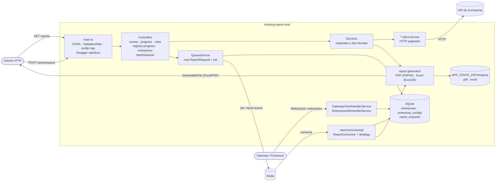
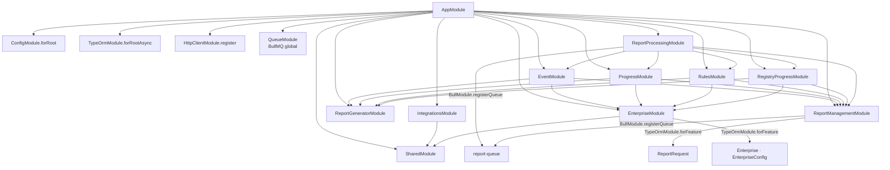
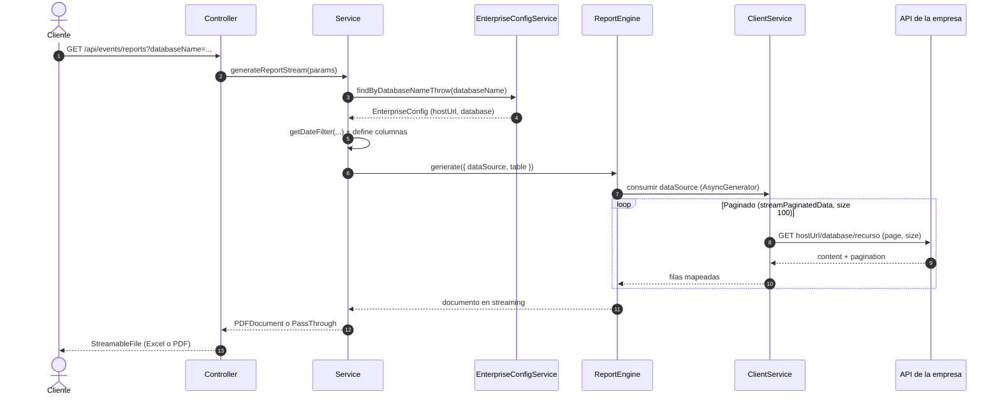
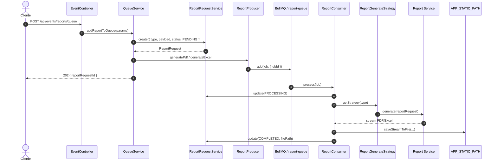
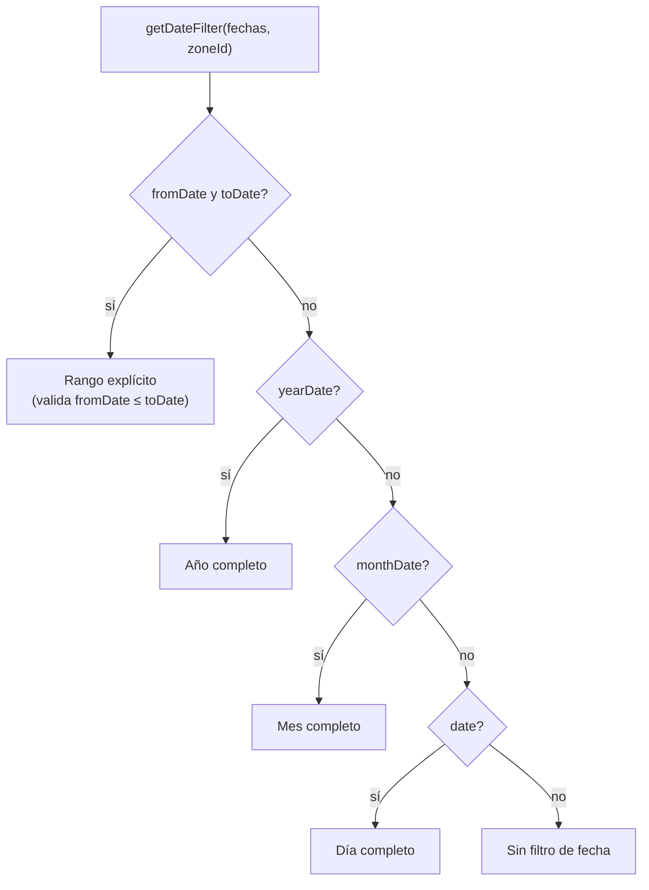
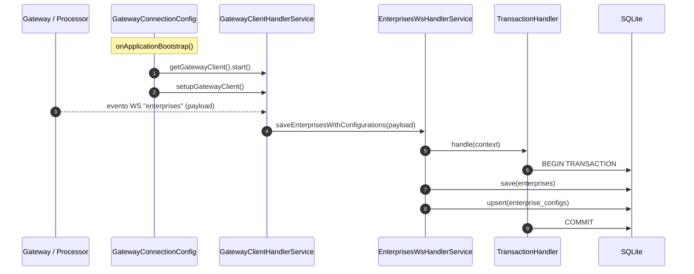

# 05 — Arquitectura

## Visión general

`tracking-report-nest` es un servicio NestJS con cuatro responsabilidades:

1. **Servidor HTTP** — recibe peticiones de reportes y las resuelve devolviendo
   Excel o PDF en streaming, o las encola para procesamiento asíncrono.
2. **Cliente WebSocket** — se conecta a un *gateway/processor* central para recibir
   el catálogo de empresas y sus configuraciones de base de datos.
3. **Procesador de cola** — consume jobs de **BullMQ/Redis**, genera los archivos y
   actualiza el estado de cada solicitud.
4. **API de soporte** — CRUD de empresas, listado de solicitudes y Swagger.

Los datos de rastreo **no viven aquí**: viven en las bases de datos operativas de
cada empresa, a las que se accede por HTTP.



Para ver el grafo de dependencias entre módulos NestJS, consulta
[Grafo de módulos](#grafo-de-módulos).

## Arranque de la aplicación

`src/main.ts`:

- Crea la app Nest desde `AppModule`.
- Habilita **CORS** con `origin: '*'` (métodos `GET/HEAD/PUT/PATCH/POST/DELETE`).
- Fija el **prefijo global `api`** en todas las rutas.
- Registra un **`ValidationPipe` global** con:
  - `whitelist: true` (elimina propiedades no declaradas),
  - `forbidNonWhitelisted: true` (rechaza propiedades desconocidas),
  - `transform: true` (convierte tipos según los DTOs),
  - `transformOptions: { exposeUnsetFields: false, enableImplicitConversion: false }`.
- Configura **Swagger** en `/api/docs` (`Tracking Reports API`, versión `1.0.0`).
- Escucha en `APP_PORT`.

`src/app.module.ts` registra:

| Registro | Propósito |
|---|---|
| `ConfigModule.forRoot` | Carga `.env` con validación Zod global. |
| `TypeOrmModule.forRootAsync` | Conexión SQLite (`better-sqlite3`), WAL activado, `autoLoadEntities`, `synchronize: false` y `migrationsRun` cuando `NODE_ENV==='test'`. |
| `HttpClientModule.register` | Cliente HTTP global con timeout `10s`. |
| `EnterpriseModule` | CRUD y configuración de empresas. |
| `SharedModule` | `TransactionHandler` reutilizable. |
| `IntegrationsModule` | Gateway WS (el `SchedulerCommonService` que registra es código muerto). |
| `QueueModule` | Configuración de BullMQ/Redis para la cola de reportes. |
| `ReportGeneratorModule` | Motor reutilizable de PDF y Excel. |
| `ReportManagementModule` | Entidad `ReportRequest`, productor y listado de solicitudes. |
| `EventModule` / `ProgressModule` / `RulesModule` / `RegistryProgressModule` | Reportes (streaming + encolado + consumidor). |
| `ReportProcessingModule` | Consumidor BullMQ y estrategia de generación. |

Las migraciones se registran por glob
(`fileURLToPath(new URL('./database/migrations/*.{ts,js}', import.meta.url))`) y solo
se ejecutan automáticamente al arrancar si `NODE_ENV === 'test'`.

### Grafo de módulos



## Módulos de reporte (patrón común)

Los cuatro módulos de reporte (`event`, `progress`, `rules`, `registry-progress`)
siguen la misma estructura. Tomemos `event` como ejemplo:

```text
event/
├── event.module.ts                  # imports: ReportGeneratorModule, ReportManagementModule, EnterpriseModule
├── event.controller.ts              # GET /events/reports · POST /events/reports/queue
├── dto/
│   └── event-report-query-params.ts # Validación de query params/body
├── interfaces/                      # Contratos (cliente, respuesta, servicio)
├── mapper/                          # Transforma respuesta externa → modelo interno
├── common/                          # Helpers para formatear celdas
└── services/
    ├── event.service.ts             # Orquesta: resuelve empresa, elige PDF/Excel, define columnas
    ├── event-client.service.ts      # Consulta HTTP paginada a la API de la empresa
    ├── queue.service.ts             # Crea ReportRequest y publica el job
    └── event-consumer.service.ts    # Implementa ReportGenerator para la cola
```

### Flujo de una petición de reporte síncrona

1. **Controller** (`event.controller.ts`) recibe `@Query()` y valida con el DTO.
2. **Service** (`event.service.ts`):
   - Resuelve la `EnterpriseConfig` por `databaseName`
     (`findByDatabaseNameThrow`).
   - Según `format` (`pdf` por defecto), llama a `handlePdf` o `handleExcel`.
   - Define encabezados, columnas y cómo se renderiza cada fila.
   - Crea un **`dataSource`**: una función que devuelve un `AsyncGenerator`.
3. **`*-client.service`** consulta la API de la empresa:
   - Transforma filtros al formato de la API (`[campo][operador]`).
   - Pagina automáticamente con `streamPaginatedData` (tamaño de página 100).
   - Mapea la respuesta con el `mapper` a un modelo interno.
4. **Motor de reporte** (`report-generator/`):
   - **PDF:** `PdfReportServiceImpl` inicializa el documento (PDFKit) y construye
     la tabla con `reportTable`.
   - **Excel:** `ExcelReportServiceImpl` crea un `WorkbookWriter` en streaming y
     construye la hoja con `tableReport`.
5. El controller envuelve la respuesta con `pdfStreamResponse` /
   `excelStreamResponse`, devolviendo un `StreamableFile` con las cabeceras adecuadas.



## Procesamiento asíncrono de reportes

El encolado permite generar el documento fuera del ciclo HTTP. La infraestructura
está repartida en tres módulos:

- **`src/infrastructure/queue/`** — `QueueModule` configura BullMQ (`REDIS_HOST`,
  `REDIS_PORT`, reintentos, backoff y retención de jobs) y
  `queue-values.ts` define `REPORT_QUEUE_NAME = 'report-queue'` y los jobs
  `generate-pdf` / `generate-excel`.
- **`src/report-management/`** — `ReportRequest` (`report_requests`),
  `ReportProducer`, `ReportRequestService` y `ReportController`.
- **`src/report-processing/`** — `ReportConsumer`,
  `ReportGenerateStrategyService`, el token `REPORT_GENERATORS` y la lista de
  `*ConsumerService`.

### Encolado

Cada módulo de reporte expone `POST /api/<reporte>/reports/queue` con el mismo DTO
que su `GET` (body JSON). El `QueueService` del módulo:

1. Valida que exista la configuración de la empresa (`databaseName`).
2. Crea un `ReportRequest` con `type` (`event`, `progress`, `rules`,
   `registry-progress`), `payload` y estado `PENDING`.
3. Publica un job en `report-queue`:
   - `format=pdf` → `generate-pdf`
   - `format=excel` → `generate-excel`
4. Responde `202 Accepted` con `{ reportRequestId }`.

### Procesamiento

`ReportConsumer` (`@Processor('report-queue', { concurrency: 2 })`):

1. Lee el `reportRequestId` del job y busca el `ReportRequest`.
2. Lo marca como `PROCESSING`.
3. Obtiene el generador según `type` con `ReportGenerateStrategyService`.
4. Genera el documento llamando al `*ConsumerService`, que delega en el service del
   reporte (mismo flujo que el `GET`).
5. Guarda el stream en
   `APP_STATIC_PATH/reports/{pdf,excel}/report-<reportRequestId>.<ext>` con
   `saveStreamToFile` (escritura atómica vía archivo temporal + `rename`).
6. Actualiza el `ReportRequest` a `COMPLETED` con `file_path`.
7. Si falla, lo marca `FAILED` con `error_message` y relanza el error para que
   BullMQ aplique reintentos/backoff.

La extensión se determina por el nombre del job; si el job es desconocido, el
consumidor lanza un error.

### Consulta de solicitudes

`ReportController` expone `GET /api/reports/queue`, que lista los `ReportRequest`
paginados (`page`, `size`, `sortBy`, `descending`) con la forma
`{ data, pagination: { count, pages } }`.

Hoy **no existe**:

- `POST /api/reports/queue` (el método está comentado),
- consulta de una solicitud por id,
- endpoint para descargar el archivo generado,
- servicio estático de `APP_STATIC_PATH` en Nest.



## Filtros de fecha

`getDateFilter` (`src/shared/utils/get-date-filter.ts`) convierte las entradas
(`date`, `fromDate`, `toDate`, `monthDate`, `yearDate`) y una `zoneId` en un rango
`fromDate`/`toDate` en *epoch milliseconds*, ajustado a la zona horaria del cliente.



Si `fromDate > toDate`, `getDateFilter` lanza un `Error` (Nest responde `500`).

## Ingesta de empresas por WebSocket

1. Al arrancar, `GatewayConnectionConfig.onApplicationBootstrap` arranca el
   `NodeControllerClient` y registra los listeners (`setupGatewayClient`).
2. `GatewayClientHandlerService` escucha el evento **`enterprises`** y delega en
   `EnterprisesWsHandlerService`.
3. `EnterprisesWsHandlerService` transforma el payload (`EnterpriseWsPayload[]`) a
   entidades y, dentro de una **transacción**:
   - Hace `save` de las empresas.
   - Hace `upsert` de las configuraciones con clave de conflicto
     `['database', 'referenceId', 'enterprise']`.

El resultado queda en SQLite: cada empresa con una o más configuraciones de
conexión (`host`, `port`, `database`, `referenceId`).



## Scheduler interno (código muerto)

`SchedulerCommonService` (scope `TRANSIENT`) mantiene un mapa de eventos y, al ejecutar
`start()`, crearía tres `setInterval` para los eventos `time.ping`, `time.save` y
`time.storage`.

Sin embargo, **no se usa**: `IntegrationsModule` lo registra como *provider* pero nadie
lo inyecta ni llama a `start()`. Además, su constructor lee con `getOrThrow`
`PING_INTERVAL_MS`, `STORAGE_INTERVAL_HRS` y `SAVE_INTERVAL_MIN`, variables que ya no
existen en el esquema Zod ni en los `.env`: si se instanciara, fallaría. Está pendiente
de eliminar (ver [01 — Estado actual](./01-estado-actual.md)).

## Patrones y principios destacados

- **Inyección por token abstracto:** `PdfReportService`, `ExcelReportService` y
  `TransactionHandler` son clases abstractas; los módulos proveen su
  implementación con `useClass`. Permite sustituir/extender implementaciones y
  facilita el testing.
- **Strategy para la cola:** `ReportGenerateStrategyService` resuelve el
  `ReportGenerator` por `type`; los cuatro `*ConsumerService` se inyectan con el
  token `REPORT_GENERATORS`. Agregar un tipo de reporte implica sumarlo a la lista
  del token y a `ReportTypeEnum`.
- **Separación de responsabilidades:** el *client service* habla con el mundo
  externo; el *service* orquesta y da formato; el motor `report-generator/` solo
  dibuja; el `report-processing/` solo consume y persiste.
- **Streaming de punta a punta:** desde la API externa (paginado) hasta la
  respuesta HTTP o el archivo, evitando cargar todo en memoria.
- **ESM + `nodenext`:** imports con extensión `.js` (p. ej. `./app.module.js`),
  requerido por Node ESM.
