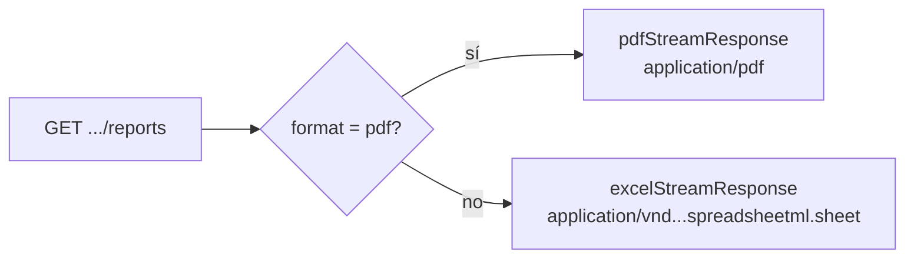

# 06 — API

Todas las rutas están bajo el prefijo global **`/api`** y se sirven en `APP_PORT`
(por defecto `10801` en desarrollo).

- Base URL de ejemplo: `http://localhost:10801/api`
- **Swagger UI:** `http://localhost:10801/api/docs`

---

## Resumen de endpoints

| Método | Ruta | Descripción |
|---|---|---|
| `GET` | `/api/events/reports` | Reporte de **eventos** (stream). |
| `GET` | `/api/progress/reports` | Reporte de **progreso** (stream). |
| `GET` | `/api/rules/reports` | Reporte de **reglas** (stream). |
| `GET` | `/api/registry-progress/reports` | Reporte de **progreso de registro** (stream). |
| `POST` | `/api/events/reports/queue` | Encola un reporte de eventos. |
| `POST` | `/api/progress/reports/queue` | Encola un reporte de progreso. |
| `POST` | `/api/rules/reports/queue` | Encola un reporte de reglas. |
| `POST` | `/api/registry-progress/reports/queue` | Encola un reporte de progreso de registro. |
| `GET` | `/api/reports/queue` | Lista paginada de solicitudes de reporte. |
| `POST` | `/api/enterprises` | Crear empresa con sus configuraciones. |
| `GET` | `/api/enterprises` | Listar empresas (paginado). |
| `GET` | `/api/enterprises/:id` | Obtener una empresa. |
| `DELETE` | `/api/enterprises/:id` | Eliminar una empresa. |

> No existe `PATCH /api/enterprises/:id` aunque `UpdateEnterpriseDto` esté definido.
> Tampoco existen los antiguos endpoints CRUD de `/api/report-management`.

> La validación global usa `whitelist` + `forbidNonWhitelisted`: **enviar un
> parámetro no declarado produce un error `400`**.

---

## Parámetros comunes a los reportes

Los cuatro DTOs de reporte extienden la misma base
(`ReportParamDto` + `PaginationDto` + `ReportParamWithDateDto`).

### Identificación y formato

| Parámetro | Tipo | Requerido | Default | Descripción |
|---|---|---|---|---|
| `databaseName` | string | ✅ | — | Nombre/codename de la base de datos de la empresa. Determina qué configuración de conexión se usa. |
| `format` | `excel` \| `pdf` | ❌ | `pdf` | Formato de salida. |
| `disposition` | `inline` \| `attachment` | ❌ | `inline` | Solo aplica a PDF: si se muestra en el navegador o se descarga. El Excel siempre se entrega como `attachment`. |
| `fileName` | string | ❌ | `example` | Nombre base del archivo (sin extensión). |
| `title` | string | ❌ | — | Título mostrado en el encabezado del reporte. |
| `filterByLabel` | string | ❌ | — | Texto descriptivo del filtro aplicado, mostrado en el encabezado. |



### Paginación / orden

| Parámetro | Tipo | Default | Descripción |
|---|---|---|---|
| `sortBy` | string | `id` | Campo por el que ordenar. |
| `descending` | boolean (`"true"`) | `false` | Orden descendente. |
| `page` | entero ≥ 0 | `0` | Página inicial (el streaming interno pagina automáticamente). |
| `size` | entero ≥ 1 | `10` | Tamaño de página del pedido externo (el streaming interno usa 100). |

### Fechas (ISO 8601 *instant*)

Se parsean con `Temporal.Instant.from` y se convierten en un rango de *epoch
milliseconds*, ajustado a la `zoneId` del cliente.

| Parámetro | Tipo | Descripción |
|---|---|---|
| `zoneId` | string | Zona horaria IANA (p. ej. `America/La_Paz`) usada para calcular los límites del día/mes/año. Si se omite, se usa `UTC`. |
| `date` | string ISO | Un día concreto. |
| `fromDate` | string ISO | Inicio de un rango (debe ser ≤ `toDate`). |
| `toDate` | string ISO | Fin de un rango. |
| `monthDate` | string ISO | Cualquier fecha del mes a reportar. |
| `yearDate` | string ISO | Cualquier fecha del año a reportar. |

Prioridad del filtro de fechas: `fromDate`+`toDate` → `yearDate` → `monthDate` → `date`.
Si solo se envía uno de `fromDate`/`toDate`, se ignora.

Ejemplo de fecha válida: `2026-01-01T00:00:00Z`.

---

## `GET /api/events/reports` — Reporte de eventos

Parámetros adicionales:

| Parámetro | Tipo | Descripción |
|---|---|---|
| `vehicleId` | string | Filtra por vehículo. |
| `ruleId` | string | Filtra por regla. |
| `inout` | string | Entrada/salida. |
| `geofenceId` | string | Filtra por geocerca. |
| `type` | string o string[] | Tipo(s) de evento (se normaliza a array). |
| `deventId` | string | ID del detalle de evento. |

**Columnas del reporte:** Nro, Fecha, Tipo, Regla, Vehículo, Evento.

```bash
# PDF (formato por defecto)
curl -o eventos.pdf \
  "http://localhost:10801/api/events/reports?databaseName=empresa1&fromDate=2026-01-01T00:00:00Z&toDate=2026-01-31T23:59:59Z&zoneId=America/La_Paz"

# Excel
curl -o eventos.xlsx \
  "http://localhost:10801/api/events/reports?databaseName=empresa1&format=excel&title=Eventos&fileName=eventos&type=exceso_velocidad"
```

---

## `GET /api/progress/reports` — Reporte de progreso

No agrega parámetros propios (solo los comunes).

**Columnas del reporte:** Nro, Nombre, Frecuencia, Alcance, Contexto Operativo, Registros.

```bash
curl -o progreso.xlsx \
  "http://localhost:10801/api/progress/reports?databaseName=empresa1&format=excel&fileName=progreso&monthDate=2026-03-15T00:00:00Z&zoneId=America/La_Paz"
```

---

## `GET /api/rules/reports` — Reporte de reglas

Parámetros adicionales:

| Parámetro | Tipo | Descripción |
|---|---|---|
| `type` | string o string[] | Tipo(s) de regla. |
| `frequencyWeekday` | string o string[] | Día(s) de la semana de frecuencia. |

**Columnas del reporte:** Nro, Nombre, Frecuencia, Eventos, Alcance, Contexto Operativo.

```bash
curl -o reglas.pdf \
  "http://localhost:10801/api/rules/reports?databaseName=empresa1&title=Reglas&type=geocerca&frequencyWeekday=1"
```

---

## `GET /api/registry-progress/reports` — Reporte de progreso de registro

Parámetros adicionales:

| Parámetro | Tipo | Descripción |
|---|---|---|
| `type` | string o string[] | Tipo(s). |
| `vehicleId` | string o string[] | Vehículo(s). |
| `progressId` | string o string[] | Progreso(s). |

**Columnas del reporte:** Nro, Desde, Hasta, Tipo, Nombre, Vehículo, Progreso (%).

```bash
curl -o registro.xlsx \
  "http://localhost:10801/api/registry-progress/reports?databaseName=empresa1&format=excel&vehicleId=ABC123&yearDate=2026-06-01T00:00:00Z"
```

---

## Encolado de reportes

Cada reporte tiene un `POST` equivalente a su `GET`, pero recibe los parámetros en
el **body JSON** y responde `202 Accepted`:

```json
{ "reportRequestId": "040e4f33-0c87-40c5-886a-4980ea8a48b4" }
```

El `format` del body decide el job (`generate-pdf` o `generate-excel`). El body usa
el mismo DTO que el `GET`, incluidos los filtros y fechas.

```bash
curl -X POST http://localhost:10801/api/events/reports/queue \
  -H "Content-Type: application/json" \
  -d '{
    "databaseName": "empresa1",
    "format": "pdf",
    "title": "Eventos",
    "fileName": "eventos",
    "fromDate": "2026-01-01T00:00:00Z",
    "toDate": "2026-01-31T23:59:59Z",
    "zoneId": "America/La_Paz"
  }'
```

### Ciclo de vida

| Estado | Significado |
|---|---|
| `PENDING` | Solicitud creada y job encolado. |
| `PROCESSING` | El consumidor tomó el job y está generando el archivo. |
| `COMPLETED` | Archivo generado; `file_path` contiene la ruta relativa. |
| `FAILED` | Falló la generación; `error_message` contiene el detalle. BullMQ puede reintentar según `BULLMQ_*`. |

El archivo se guarda en:

```text
<APP_STATIC_PATH>/reports/pdf/report-<reportRequestId>.pdf
<APP_STATIC_PATH>/reports/excel/report-<reportRequestId>.xlsx
```

> Hoy no hay endpoint para descargar el archivo ni para consultar una solicitud por
> id. Nest tampoco sirve `APP_STATIC_PATH` estáticamente.

### `GET /api/reports/queue` — Listar solicitudes

Acepta los parámetros de paginación (`page`, `size`, `sortBy`, `descending`) y
devuelve:

```json
{
  "data": [
    {
      "id": "040e4f33-0c87-40c5-886a-4980ea8a48b4",
      "type": "event",
      "payload": { "databaseName": "empresa1", "format": "pdf" },
      "status": "COMPLETED",
      "filePath": "reports/pdf/report-040e4f33-0c87-40c5-886a-4980ea8a48b4.pdf",
      "errorMessage": null,
      "createdAt": "2026-01-31T12:00:00.000Z",
      "createdBy": "system",
      "updatedAt": "2026-01-31T12:00:05.000Z",
      "updatedBy": "system"
    }
  ],
  "pagination": { "count": 1, "pages": 1 }
}
```

```bash
curl "http://localhost:10801/api/reports/queue?page=0&size=10&descending=true"
```

---

## Endpoints de empresas

### `POST /api/enterprises` — Crear empresa

Body (`CreateEnterpriseDto`):

| Campo | Tipo | Requerido | Descripción |
|---|---|---|---|
| `id` | string | ❌ | ID de la empresa. |
| `name` | string | ✅ | Nombre de la empresa. |
| `description` | string | ❌ | Descripción. |
| `color` | string | ❌ | Color asociado. |
| `image` | string | ❌ | Logo (URL o base64). |
| `enterpriseConfigs` | array | ✅ | Lista de configuraciones de conexión. |

Cada elemento de `enterpriseConfigs` (`CreateEnterpriseConfigDto`):

| Campo | Tipo | Requerido | Descripción |
|---|---|---|---|
| `host` | string | ✅ | Host de la API de la empresa. |
| `port` | string | ✅ | Puerto de la API. |
| `database` | string | ✅ | Codename de la base de datos. |
| `referenceId` | string | ✅ | ID de referencia de la base. |
| `enterpriseRefId` | string | ❌ | Se resuelve internamente al crear. |

**Respuesta:** el `id` de la empresa creada.

```bash
curl -X POST http://localhost:10801/api/enterprises \
  -H "Content-Type: application/json" \
  -d '{
    "name": "Empresa Demo",
    "color": "#FF0000",
    "enterpriseConfigs": [
      { "host": "172.20.50.10", "port": "8080", "database": "empresa1", "referenceId": "db-001" }
    ]
  }'
```

> La validación anidada de `enterpriseConfigs` no está aplicada actualmente
> (no hay `@ValidateNested`/`@Type`); los campos se validan al persistir.

### `GET /api/enterprises` — Listar empresas

Acepta `page`, `size`, `sortBy`, `descending` y devuelve
`{ data, pagination: { count, pages } }`.

```bash
curl "http://localhost:10801/api/enterprises?page=0&size=10"
```

### `GET /api/enterprises/:id` — Obtener empresa

Devuelve la empresa o `404` si no existe.

```bash
curl http://localhost:10801/api/enterprises/enterprise_1
```

### `DELETE /api/enterprises/:id` — Eliminar empresa

Elimina la empresa (y sus configuraciones por `ON DELETE CASCADE`). Responde `200`
sin cuerpo; `404` si no existe.

```bash
curl -X DELETE http://localhost:10801/api/enterprises/enterprise_1
```

---

## Códigos de respuesta relevantes

| Código | Situación |
|---|---|
| `200` | Reporte, listado o empresa devueltos correctamente. |
| `202` | Solicitud de reporte encolada (`{ reportRequestId }`). |
| `400` | Query params/body inválidos (validación `class-validator`). |
| `404` | Empresa inexistente en `GET`/`DELETE /api/enterprises/:id`. |
| `500` | No existe configuración para el `databaseName` (`findOneOrFail` lanza `EntityNotFoundError`), rango de fechas inválido (`fromDate > toDate`) o error inesperado. |
| `502` | Fallo al consultar la API externa de la empresa (`BadGatewayException`). |
