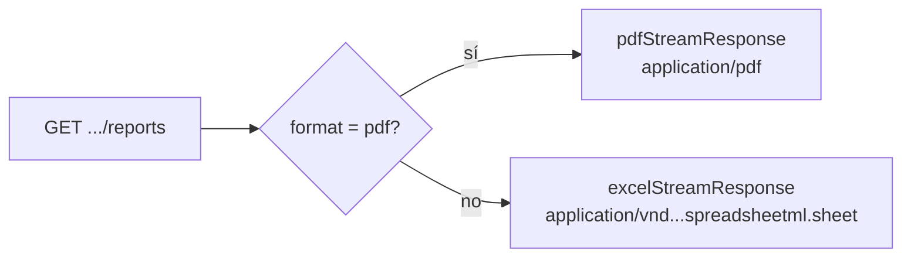

# 06 — API

Todas las rutas están bajo el prefijo global **`/api`** y se sirven en `APP_PORT`
(por defecto `10801` en desarrollo).

Base URL de ejemplo: `http://localhost:10801/api`

---

## Resumen de endpoints

| Método | Ruta | Descripción |
|---|---|---|
| `GET` | `/api/events/reports` | Reporte de **eventos**. |
| `GET` | `/api/progress/reports` | Reporte de **progreso**. |
| `GET` | `/api/rules/reports` | Reporte de **reglas**. |
| `GET` | `/api/registry-progress/reports` | Reporte de **progreso de registro**. |
| `POST` | `/api/enterprises` | Crear empresa con sus configuraciones. |
| `GET` | `/api/enterprises` | Listar empresas. *(stub, ver deuda técnica)* |
| `GET` | `/api/enterprises/:id` | Obtener empresa. *(stub)* |
| `PATCH` | `/api/enterprises/:id` | Actualizar empresa. *(stub)* |
| `DELETE` | `/api/enterprises/:id` | Eliminar empresa. *(stub)* |

> La validación global usa `whitelist` + `forbidNonWhitelisted`: **enviar un
> parámetro no declarado produce un error `400`**.

---

## Parámetros comunes a los reportes

Los cuatro endpoints de reporte extienden el mismo DTO base
(`ReportParamDto` + `PaginationDto` + `ReportParamWithDateDto`).

### Identificación y formato

| Parámetro | Tipo | Requerido | Default | Descripción |
|---|---|---|---|---|
| `databaseName` | string | ✅ | — | Nombre/codename de la base de datos de la empresa. Determina qué configuración de conexión se usa. |
| `format` | `json` \| `excel` \| `pdf` | ❌ | `json` | Formato de salida. **En la práctica:** `pdf` devuelve PDF; cualquier otro valor (incluido `json`) devuelve Excel. |
| `disposition` | `inline` \| `attachment` | ❌ | `inline` | Solo aplica a PDF: si se muestra en el navegador o se descarga. |
| `fileName` | string | ❌ | `example` | Nombre base del archivo (sin extensión). |
| `title` | string | ❌ | — | Título mostrado en el encabezado del reporte. |
| `filterByLabel` | string | ❌ | — | Texto descriptivo del filtro aplicado, mostrado en el encabezado. |



### Paginación / orden

| Parámetro | Tipo | Default | Descripción |
|---|---|---|---|
| `sortBy` | string | `id` | Campo por el que ordenar. |
| `descending` | boolean (`"true"`) | `false` | Orden descendente. |
| `page` | entero ≥ 0 | `0` | Página (el streaming interno pagina automáticamente). |
| `size` | entero ≥ 1 | `10` | Tamaño de página (el streaming interno usa 100). |

### Fechas (ISO 8601 *instant*)

Se transforman con `Temporal` y se convierten en un rango, ajustado a la `zoneId`.

| Parámetro | Tipo | Descripción |
|---|---|---|
| `zoneId` | string | Zona horaria IANA (p. ej. `America/La_Paz`) usada para calcular los límites del día/mes/año. |
| `date` | string ISO | Un día concreto. |
| `fromDate` | string ISO | Inicio de un rango (debe ser ≤ `toDate`). |
| `toDate` | string ISO | Fin de un rango. |
| `monthDate` | string ISO | Cualquier fecha del mes a reportar. |
| `yearDate` | string ISO | Cualquier fecha del año a reportar. |

Prioridad del filtro de fechas: `fromDate`+`toDate` → `yearDate` → `monthDate` → `date`.

Ejemplo de fecha válida: `2026-01-01T00:00:00Z`.

---

## `GET /api/events/reports` — Reporte de eventos

Parámetros adicionales:

| Parámetro | Tipo | Descripción |
|---|---|---|
| `vehicleId` | string | Filtra por vehículo. |
| `ruleId` | string | Filtra por regla. |
| `inout` | string | Entrada/salida. |
| `geofenceId` | string | Filtra por geocerca. |
| `type` | string o string[] | Tipo(s) de evento (se normaliza a array). |
| `deventId` | string | ID del detalle de evento. |

**Columnas del reporte:** Nro, Fecha, Tipo, Regla, Vehículo, Evento.

```bash
# Excel (por defecto)
curl -o eventos.xlsx \
  "http://localhost:10801/api/events/reports?databaseName=empresa1&format=excel&title=Eventos&fileName=eventos"

# PDF en línea
curl -o eventos.pdf \
  "http://localhost:10801/api/events/reports?databaseName=empresa1&format=pdf&disposition=inline&fromDate=2026-01-01T00:00:00Z&toDate=2026-01-31T23:59:59Z&zoneId=America/La_Paz&type=exceso_velocidad"
```

---

## `GET /api/progress/reports` — Reporte de progreso

No agrega parámetros propios (solo los comunes).

**Columnas del reporte:** Nro, Nombre, Frecuencia, Alcance, Contexto Operativo, Registros.

```bash
curl -o progreso.xlsx \
  "http://localhost:10801/api/progress/reports?databaseName=empresa1&format=excel&fileName=progreso&monthDate=2026-03-15T00:00:00Z&zoneId=America/La_Paz"
```

---

## `GET /api/rules/reports` — Reporte de reglas

Parámetros adicionales:

| Parámetro | Tipo | Descripción |
|---|---|---|
| `type` | string o string[] | Tipo(s) de regla. |
| `frequencyWeekday` | string o string[] | Día(s) de la semana de frecuencia. |

**Columnas del reporte:** Nro, Nombre, Frecuencia, Eventos, Alcance, Contexto Operativo.

```bash
curl -o reglas.pdf \
  "http://localhost:10801/api/rules/reports?databaseName=empresa1&format=pdf&title=Reglas&type=geocerca&frequencyWeekday=1"
```

---

## `GET /api/registry-progress/reports` — Reporte de progreso de registro

Parámetros adicionales:

| Parámetro | Tipo | Descripción |
|---|---|---|
| `type` | string o string[] | Tipo(s). |
| `vehicleId` | string o string[] | Vehículo(s). |
| `progressId` | string o string[] | Progreso(s). |

**Columnas del reporte:** Nro, Desde, Hasta, Tipo, Nombre, Vehículo, Progreso (%).

```bash
curl -o registro.xlsx \
  "http://localhost:10801/api/registry-progress/reports?databaseName=empresa1&format=excel&vehicleId=ABC123&yearDate=2026-06-01T00:00:00Z"
```

---

## Endpoints de empresas

### `POST /api/enterprises` — Crear empresa

Body (`CreateEnterpriseDto`):

| Campo | Tipo | Requerido | Descripción |
|---|---|---|---|
| `id` | string | ❌ | ID de la empresa. |
| `name` | string | ✅ | Nombre de la empresa. |
| `description` | string | ❌ | Descripción. |
| `color` | string | ❌ | Color asociado. |
| `image` | string | ❌ | Logo (URL o base64). |
| `enterpriseConfigs` | array | ✅ | Lista de configuraciones de conexión. |

Cada elemento de `enterpriseConfigs` (`CreateEnterpriseConfigDto`):

| Campo | Tipo | Requerido | Descripción |
|---|---|---|---|
| `host` | string | ✅ | Host de la API de la empresa. |
| `port` | string | ✅ | Puerto de la API. |
| `database` | string | ✅ | Codename de la base de datos. |
| `referenceId` | string | ✅ | ID de referencia de la base. |
| `enterpriseRefId` | string | ❌ | Se resuelve internamente al crear. |

**Respuesta:** el `id` de la empresa creada.

```bash
curl -X POST http://localhost:10801/api/enterprises \
  -H "Content-Type: application/json" \
  -d '{
    "name": "Empresa Demo",
    "color": "#FF0000",
    "enterpriseConfigs": [
      { "host": "172.20.50.10", "port": "8080", "database": "empresa1", "referenceId": "db-001" }
    ]
  }'
```

### `GET/PATCH/DELETE /api/enterprises/:id` y `GET /api/enterprises`

Actualmente **no operan sobre la base de datos** (devuelven texto de ejemplo). Ver
[01 — Estado actual](./01-estado-actual.md).

---

## Códigos de respuesta relevantes

| Código | Situación |
|---|---|
| `200` | Reporte o empresa devueltos correctamente. |
| `400` | Query params/body inválidos (validación `class-validator`). |
| `404` | No existe configuración de empresa para el `databaseName` (`findOneOrFail`). |
| `502` | Fallo al consultar la API externa de la empresa (`BadGatewayException`). |
