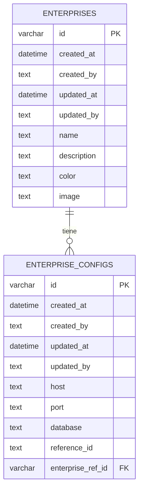

# 07 — Base de datos

## Motor

El servicio usa **SQLite** a través del driver **better-sqlite3**, gestionado por
**TypeORM**. La configuración vive en `src/app.module.ts`:

```ts
TypeOrmModule.forRootAsync({
  inject: [ConfigService],
  useFactory: (config: ConfigService) => ({
    type: 'better-sqlite3',
    database: config.getOrThrow<string>('DB_URL'),
    enableWAL: true,
    autoLoadEntities: true,
    synchronize: false,
    migrations: [
      fileURLToPath(new URL('./database/migrations/*.{ts,js}', import.meta.url)),
    ],
    migrationsRun: config.getOrThrow<string>('NODE_ENV') === 'test',
  }),
});
```

Puntos clave:

- **`database`** se toma de la variable de entorno `DB_URL`.
- **`enableWAL: true`** activa el modo *Write-Ahead Logging*. Por eso existen los
  archivos `-wal` y `-shm` junto al `.sqlite`.
- **`autoLoadEntities: true`** registra las entidades declaradas con
  `TypeOrmModule.forFeature`.
- **`synchronize: false`** es importante: **el esquema NO se sincroniza
  automáticamente**. Todo cambio de esquema requiere una **migración**.
- **`migrationsRun`** ejecuta las migraciones pendientes al arrancar, pero **solo
  en `NODE_ENV=test`** (así lo levantan las pruebas e2e sobre `:memory:`). En
  desarrollo/producción se aplican con `pnpm migration:run`.

> La base de datos **no** almacena datos de rastreo; solo el **catálogo de empresas
> y sus configuraciones**. Los datos de rastreo viven en las APIs externas.

## Entidades

### `Enterprise` → tabla `enterprises`

`src/modules/enterprise/entities/enterprise.entity.ts`

| Columna | Tipo | Nulo | Descripción |
|---|---|---|---|
| `id` | varchar (uuid) | no | PK (heredada de `BaseEntity`). |
| `created_at` | datetime | no | Heredada. |
| `created_by` | text | no | Heredada (default `system`). |
| `updated_at` | datetime | no | Heredada. |
| `updated_by` | text | no | Heredada (default `system`). |
| `name` | text | no | Nombre de la empresa. |
| `description` | text | sí | Descripción. |
| `color` | text | sí | Color asociado. |
| `image` | text | sí | Logo. |

Relación: `OneToMany` con `EnterpriseConfig`.

### `EnterpriseConfig` → tabla `enterprise_configs`

`src/modules/enterprise/entities/enterprise-config.entity.ts`

| Columna | Tipo | Nulo | Descripción |
|---|---|---|---|
| `id` | varchar (uuid) | no | PK (heredada de `BaseEntity`). |
| `created_at`, `created_by`, `updated_at`, `updated_by` | — | no | Heredadas. |
| `host` | text | no | Host de la API de la empresa. |
| `port` | text | no | Puerto de la API. |
| `database` | text | no | Codename de la base de datos. |
| `reference_id` | text | no | ID de referencia de la base. |
| `enterprise_ref_id` | varchar (FK) | no | FK → `enterprises.id`, `ON DELETE CASCADE`. |

- **Índice único:** `uq_configs_database_ref_id_enterprise_ref_id` sobre
  (`database`, `reference_id`, `enterprise_ref_id`). Es la clave que usa el *upsert*
  al recibir empresas por WebSocket.
- **Propiedad calculada:** `hostUrl` devuelve `http://${host}:${port}` (usada por los
  *client services*).

### `BaseEntity` (abstracta)

`src/shared/db/base-entity.ts` aporta a cada entidad:

- `id`: `@PrimaryGeneratedColumn('uuid')`
- `createdAt` / `createdBy`
- `updatedAt` / `updatedBy`

## Transacciones

El acceso transaccional se centraliza en el token abstracto `TransactionHandler`
(`src/shared/db/transaction/`):

```ts
export abstract class TransactionHandler {
  abstract handle<T>(
    transaction: (context: TransactionContext) => Promise<T>,
  ): Promise<T>;
}
```

- `TransactionHandlerImpl` abre una transacción con `DataSource.transaction` y
  expone en el `TransactionContext` los repositorios de `Enterprise` y
  `EnterpriseConfig`.
- `SharedModule` registra la implementación con
  `{ provide: TransactionHandler, useClass: TransactionHandlerImpl }`.

Se usa, por ejemplo, en `EnterprisesWsHandlerService` (guardar empresa + upsert de
configs de forma atómica) y en `EnterpriseService.create`.

## Migraciones

- Ubicación: `src/database/migrations/`.
- Nombres: `<timestamp>-auto-migration.ts` (generadas con TypeORM).
- El `DataSource` de la CLI es `src/database/data-source.ts`, que apunta a las
  entidades/migraciones **compiladas** (`dist/**/*.entity.js`,
  `dist/database/migrations/*.js`).

### Migraciones existentes

| Migración | Qué hace |
|---|---|
| `1790803023261` | Crea la tabla `enterprises`. |
| `1790805293957` | Crea `enterprise_configs` y añade la FK a `enterprises` con `ON DELETE CASCADE`. |
| `1790806074206` | Crea el índice único `uq_configs_database_ref_id_enterprise_ref_id`. |

### Comandos

```bash
pnpm migration:generate   # genera a partir de cambios en entidades
pnpm migration:run        # aplica pendientes
pnpm migration:revert     # revierte la última
pnpm migration:validate   # muestra el SQL pendiente (schema:log)
```

Todos compilan primero (`nest build`) porque el `DataSource` apunta a `dist/`.

> ⚠️ `src/database/data-source.ts` tiene la ruta de la BD **hardcodeada**
> (`database/tracking-report.sqlite`) y **no** usa `DB_URL`. Si necesitas migrar
> otra base, ajusta ese archivo o el script. Ver
> [01 — Estado actual](./01-estado-actual.md).

## Diagrama de relaciones



> `reference_id`, `database` y `enterprise_ref_id` forman el índice único
> `uq_configs_database_ref_id_enterprise_ref_id`.

Flujo típico: el *processor* envía empresas por WebSocket → se hace *upsert* de la
empresa y sus configuraciones → las peticiones de reporte resuelven la configuración
por `database` (codename) para saber a qué `host:port` llamar.
