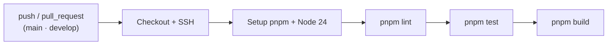

# 08 — Testing y calidad

## Herramientas

| Herramienta | Rol |
|---|---|
| **Vitest** | Runner de pruebas unitarias y e2e. |
| **`@vitest/coverage-v8`** | Cobertura. |
| **Supertest** | Peticiones HTTP en pruebas e2e. |
| **oxlint + oxlint-tsgolint** | Linting (incluye reglas *type-aware*). |
| **Prettier** | Formateo. |
| **GitHub Actions** | Ejecuta lint + tests + build en CI. |

## Configuración de Vitest

El proyecto tiene **dos configuraciones**:

### Unitarias — `vitest.config.ts`

```ts
test: {
  globals: false,
  root: './',
  include: ['**/*.spec.ts'],
}
```

- Sin `globals` (hay que importar `describe`, `it`, etc. desde `vitest`).
- Incluye todos los `*.spec.ts`.
- Resuelve alias de `tsconfig.json` (`resolve.tsconfigPaths`).

### E2E — `vitest.config.e2e.ts`

```ts
test: {
  globals: false,
  root: './',
  include: ['**/*.e2e-spec.ts'],
  environment: 'node',
  env: { NODE_ENV: 'test' },
}
```

- Incluye `*.e2e-spec.ts`.
- Fuerza `NODE_ENV=test`, por lo que la app carga `.env.test`.

## Convenciones de nombres

- **Unitarias:** `*.spec.ts` colocadas junto al archivo probado (p. ej.
  `event.service.spec.ts` junto a `event.service.ts`).
- **E2E:** `test/*.e2e-spec.ts`.

## Comandos

```bash
pnpm test          # unitarias
pnpm test:watch    # unitarias en watch
pnpm test:cov      # con cobertura
pnpm test:debug    # con inspector (--inspect-brk)
pnpm test:e2e      # end-to-end
```

> ⚠️ El test e2e actual (`test/app.e2e-spec.ts`) espera `Hello World!` en `GET /`,
> ruta que no existe con el prefijo `api`. Ver
> [01 — Estado actual](./01-estado-actual.md).

## Linting (oxlint)

Configuración en `.oxlintrc.json`:

```json
{
  "rules": {
    "no-undef": "error",
    "no-unreachable": "error",
    "typescript/no-floating-promises": "error",
    "typescript/no-misused-promises": "error",
    "typescript/await-thenable": "error",
    "typescript/no-explicit-any": "off"
  },
  "env": { "node": true }
}
```

- Reglas relevantes: promesas no manejadas y `await` sobre valores no *thenable*
  son **errores**.
- `no-explicit-any` está **desactivado** (permitido).
- Documentación: https://oxc.rs

```bash
pnpm lint
```

## Formateo (Prettier)

`.prettierrc`:

```json
{ "singleQuote": true, "trailingComma": "all" }
```

```bash
pnpm format
```

## Integración continua (CI)

`.github/workflows/ci.yml` se ejecuta en `push` y `pull_request` a `main` y
`develop` (solo en el repositorio `Maur025/tracking-report-nest`).

Pasos:

1. Checkout del código.
2. Configura clave SSH y `known_hosts` (para instalar `tracking-common`).
3. Configura git para usar SSH en GitHub.
4. Configura pnpm + Node 24 (con caché).
5. `pnpm lint`
6. `pnpm test`
7. `pnpm build`



## Dependabot

`.github/dependabot.yml` abre PRs semanales (máximo 5) para:

- Dependencias **npm**.
- **GitHub Actions**.

## Buenas prácticas al contribuir

- Añade/actualiza pruebas junto al código (`*.spec.ts`).
- Mantén `pnpm lint` y `pnpm test` en verde antes del PR.
- No rompas el patrón de los módulos de reporte (controller → service → client →
  mapper).
- Respeta el ESM: imports con extensión `.js`.
