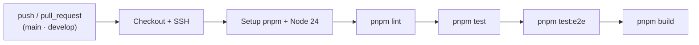

# 08 — Testing y calidad

## Herramientas

| Herramienta | Rol |
|---|---|
| **Vitest** | Runner de pruebas unitarias y e2e. |
| **`@vitest/coverage-v8`** | Cobertura. |
| **Supertest** | Peticiones HTTP en pruebas e2e. |
| **MSW** (`msw`) | Intercepta y simula la API HTTP externa de cada empresa en las pruebas e2e. |
| **oxlint + oxlint-tsgolint** | Linting (incluye reglas *type-aware*). |
| **Prettier** | Formateo. |
| **GitHub Actions** | Ejecuta lint + tests (unit + e2e) + build en CI. |

## Configuración de Vitest

El proyecto tiene **dos configuraciones**:

### Unitarias — `vitest.config.ts`

```ts
test: {
  globals: false,
  root: './',
  include: ['**/*.spec.ts'],
}
```

- Sin `globals` (hay que importar `describe`, `it`, etc. desde `vitest`).
- Incluye todos los `*.spec.ts`.
- Resuelve alias de `tsconfig.json` (`resolve.tsconfigPaths`).

### E2E — `vitest.config.e2e.ts`

```ts
test: {
  globals: false,
  root: './',
  include: ['**/*.e2e-spec.ts'],
  environment: 'node',
  env: { NODE_ENV: 'test' },
  setupFiles: ['./test/setup/e2e-test-setup.ts'],
}
```

- Incluye `*.e2e-spec.ts`.
- Fuerza `NODE_ENV=test`, por lo que la app carga `.env.test` (con `DB_URL=:memory:`
  y migraciones automáticas al arrancar).
- `setupFiles` arranca el servidor **MSW** antes de cada archivo (`listen`), resetea
  los handlers tras cada test y lo cierra al final.

## Convenciones de nombres

- **Unitarias:** `*.spec.ts` colocadas junto al archivo probado (p. ej.
  `event.service.spec.ts` junto a `event.service.ts`).
- **E2E:** `test/*.e2e-spec.ts`.

## Comandos

```bash
pnpm test          # unitarias
pnpm test:watch    # unitarias en watch
pnpm test:cov      # con cobertura
pnpm test:debug    # con inspector (--inspect-brk)
pnpm test:e2e      # end-to-end
```

> La suite e2e cubre los **cuatro reportes** y valida tanto la respuesta `pdf`
> como la `excel` (firmas `%PDF` y `PK\x03\x04`). Ver más abajo.

## Cobertura

`pnpm test:cov` mide la cobertura con **v8** sobre `src/`:

| Métrica | Actual | Objetivo |
|---|---|---|
| Statements | 98.41 % | ≥ 95 % |
| Branches | 91.74 % | ≥ 88 % |
| Functions | 96.03 % | — |
| Lines | 98.66 % | — |

Lo que **no** está cubierto y requiere dependencias externas:

- `report-management` (cola BullMQ) y `POST /api/events/reports/queue`: necesitan
  **Redis**, que CI provee pero no está disponible en local.
- `src/integrations/scheduler/`: es **código muerto** (pendiente de eliminar).

## Pruebas E2E (MSW)

Las pruebas e2e (`test/*.e2e-spec.ts`) levantan la aplicación completa con
`createTestApp` y sustituyen la API externa de la empresa por **MSW**, de modo que
no se necesita ninguna dependencia de red real. `createTestApp` también mockea
`QueueModule`, por lo que **no requieren Redis**. La suite e2e solo cubre los
cuatro reportes; el flujo de `report-management` todavía no tiene e2e.

### Archivos de soporte (`test/setup/`)

| Archivo | Rol |
|---|---|
| `create-test-app.ts` | Crea la app Nest a partir de `AppModule`, reemplaza `IntegrationsModule`, `QueueModule` y `ReportManagementModule` por módulos vacíos (mock), y aplica CORS, prefijo `api` y `ValidationPipe` (igual que `main.ts`). Gracias a esto las pruebas no necesitan WebSocket ni Redis. |
| `e2e-test-setup.ts` | `setupFiles`: arranca/limpia/cierra el servidor MSW (`beforeAll`/`afterEach`/`afterAll`). |
| `clean-database.ts` | Vacía `enterprise_configs` y `enterprises` antes de cada test. |
| `seed-enterprise-config.ts` | Inserta una empresa y su configuración (`host: event-api-test`) para que los reportes resuelvan la conexión. |
| `utils.ts` | `binaryParser` para que Supertest entregue la respuesta binaria como `Buffer`. |
| `msw/msw-server.ts` | Instancia de `setupServer(...mswHandlers)`. |
| `msw/msw-handlers.ts` | Agrupa los handlers de eventos, reglas, progreso y progreso de registro. |
| `msw/*-handler.ts` | Respuestas simuladas de la API externa por tipo de reporte. |

### Patrón de un test

```ts
app = await createTestApp();          // app completa
await cleanDatabase(dataSource);
await seedEnterpriseConfig(dataSource);

const response = await request(app.getHttpServer())
  .get('/api/events/reports')
  .query({ databaseName: 'enterprise_1_db', format: 'pdf', /* ... */ })
  .buffer(true)
  .parse(binaryParser);
```

Se verifican los casos `400` (faltan params, param desconocido, `format` o
`disposition` no soportados), `500` (empresa inexistente) y `200` (archivo
`pdf`/`excel` válido, `format` por defecto, `disposition=inline`).

> `disposition` solo se aplica a la respuesta **PDF**; el Excel siempre se devuelve
> como `attachment` (`src/shared/response/excel-stream-response.ts`).

## Linting (oxlint)

Configuración en `.oxlintrc.json`:

```json
{
  "rules": {
    "no-undef": "error",
    "no-unreachable": "error",
    "typescript/no-floating-promises": "error",
    "typescript/no-misused-promises": "error",
    "typescript/await-thenable": "error",
    "typescript/no-explicit-any": "off"
  },
  "env": { "node": true }
}
```

- Reglas relevantes: promesas no manejadas y `await` sobre valores no *thenable*
  son **errores**.
- `no-explicit-any` está **desactivado** (permitido).
- Documentación: https://oxc.rs

```bash
pnpm lint
```

## Formateo (Prettier)

`.prettierrc`:

```json
{ "singleQuote": true, "trailingComma": "all" }
```

```bash
pnpm format
```

## Integración continua (CI)

`.github/workflows/ci.yml` se ejecuta en `push` y `pull_request` a `main` y
`develop` (solo en el repositorio `Maur025/tracking-report-nest`).

Pasos:

1. Checkout del código.
2. Configura clave SSH y `known_hosts` (para instalar `tracking-common`).
3. Configura git para usar SSH en GitHub.
4. Configura pnpm + Node 24 (con caché).
5. `pnpm lint`
6. `pnpm test`
7. `pnpm test:e2e`
8. `pnpm build`



## Dependabot

`.github/dependabot.yml` abre PRs semanales (máximo 5) para:

- Dependencias **npm**.
- **GitHub Actions**.

## Buenas prácticas al contribuir

- Añade/actualiza pruebas junto al código (`*.spec.ts`).
- Mantén `pnpm lint`, `pnpm test` y `pnpm test:e2e` en verde antes del PR.
- No rompas el patrón de los módulos de reporte (controller → service → client →
  mapper).
- Respeta el ESM: imports con extensión `.js`.
